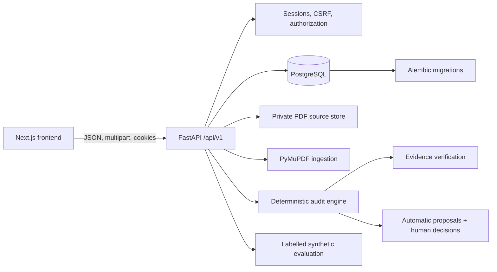

# Proofmint

> **Nothing ships unproven.**

Proofmint is a B2B pre-publication brand-verification and review platform for brand, content, legal and compliance teams. It checks marketing content against approved guidelines, terminology and supporting claim records while keeping evidence review and final clearance under human control. It is not a comprehensive autonomous semantic, legal or regulatory-verification engine.

**[Open Proofmint](https://emicproofmint.xyz/)** · [Source code](https://github.com/ViSiONiX07/Proofmint)

The custom domain is the intended canonical public URL; confirm deployment and HTTPS before treating it as verified. The existing Vercel deployment, where still active, is a fallback reference: https://proofmint-rust.vercel.app/

## Product principles and features

Evidence-backed findings, intent-preserving supported corrections, human-controlled review, traceable decisions, and brand governance.

- Seven stages: Guidelines, Evidence, Rules, Copy, Findings, Repair, Evaluation.
- Bounded PDF guideline ingestion and candidate-rule extraction.
- Approved-facts and terminology CSV imports with review states.
- Evidence verification, repair previews, persisted decisions, Ambiguity Radar, and labelled evaluation.
- Guest-first browsing with deferred authentication.
- Email/password accounts, profile initials, secure sessions, authorization, and restricted Judge Mode.
- Google OAuth remains implemented but is disabled for the current deployment.

## Round 3 improvements

### Evidence-Locked Findings

Findings retain exact matched content spans, offsets, approved-rule provenance and source-document references. Where available, source page, document version and evidence excerpts are preserved. Independent verification reports `verified`, `uncertain` or `rejected`; unsupported or uncertain evidence is handled conservatively and is not presented as verified.

### Intent-Preserving Repair and Human Review

Automatic repair is limited to verified preferred-terminology mismatches with an approved replacement. Reviewers can Accept, Edit or Reject those proposals. When no safe supported replacement exists, they can create a human-authored manual repair. Original and revised text, provenance, workspace, finding, reviewer identity where available, timestamp and append-only history are retained. Re-evaluation is required before clearance.

### Reliability, Evaluation and Ambiguity Radar

The labelled evaluation uses a version-controlled synthetic dataset and an isolated in-memory database. It reports precision, recall when denominators exist, evidence outcomes, label agreement, run consistency and safe-repair validity. Ambiguity Radar applies a minimum repeated-decision threshold before reporting a score. These are deterministic benchmark and regression signals, not real-world accuracy claims.

## Technology and architecture

| Area | Technologies |
|---|---|
| Frontend | Next.js App Router, React, TypeScript, Tailwind CSS, lucide-react |
| Backend | Python, FastAPI, Pydantic, SQLAlchemy, Alembic |
| Database | PostgreSQL; Neon where configured |
| Processing | PyMuPDF and ReportLab |
| Deployment | Vercel, Render, Neon where configured |

    apps/web/                 Next.js frontend, routes, components, styles, client workflow helpers
    services/api/app/         FastAPI routes, auth, models, schemas, services
    services/api/alembic/     Database migrations
    services/api/tests/       Backend tests
    apps/web/lib/             Frontend workflow and validation helpers
    docs/                     Design and Round 3 documentation
    samples/                  Illustrative data
    .env.example              Environment template

`apps/web` contains the App Router UI and workflow helpers. `services/api/app` contains FastAPI routes, SQLAlchemy models, Pydantic schemas, authentication/session handling and processing services. `services/api/tests` and frontend `*.test.mjs` files provide regression coverage.

## Feature inventory

| Feature | What it does | Status | Limitations |
|---|---|---|---|
| PDF guideline ingestion | Validates bounded PDFs, stores private source bytes and extracts candidate statements | Implemented, bounded scope | Deterministic extraction is not full semantic rule extraction |
| Facts and terminology CSV | Validates and transactionally imports evidence rows | Implemented | Narrow review schema and provenance model |
| Evidence verification | Checks source integrity, citations, approvals and literal evidence matches | Implemented | Does not establish universal truth or legal compliance |
| Audit engine | Finds configured literal phrases, terminology mismatches and exact fact matches | Implemented, limited scope | Not comprehensive autonomous semantic or legal verification |
| Automatic repair | Proposes approved preferred-terminology replacements | Implemented, limited scope | No arbitrary AI rewriting |
| Manual repair | Persists human-authored original/revised text and provenance | Implemented | Requires re-evaluation before clearance |
| Judge Mode | Creates isolated credential-free `judge_demo` sessions and workspaces | Implemented | Not enterprise-grade RBAC or tenant administration |
| Ambiguity Radar | Aggregates repeated review decisions after a threshold | Implemented, limited scope | Does not infer reviewer disagreement |
| Labelled evaluation | Reports synthetic precision/recall and consistency signals | Implemented | Benchmark only; no production accuracy claim |
| Google sign-in | OAuth remains behind configuration | Disabled for current deployment | Requires later provider/domain configuration |

## Prerequisites

Install Git, Node.js, npm, Python, and PostgreSQL.

    git --version
    node --version
    npm --version
    python --version
    psql --version

## Clone and backend setup

    git clone https://github.com/ViSiONiX07/Proofmint.git
    cd Proofmint
    git branch
    git status
    cd services/api
    python -m venv .venv
    .\.venv\Scripts\Activate.ps1
    pip install -r requirements.txt
    Copy-Item .env.example .env

Configure PostgreSQL using either DATABASE_URL or all individual fields. DATABASE_URL takes precedence when set.

    DATABASE_URL=
    POSTGRES_SERVER=localhost
    POSTGRES_PORT=5432
    POSTGRES_USER=proofmint_app
    POSTGRES_PASSWORD=replace_with_local_password
    POSTGRES_DB=proofmint
    APP_ENV=development
    AUTH_FRONTEND_URL=http://localhost:3000
    BACKEND_CORS_ORIGINS=["http://localhost:3000","http://127.0.0.1:3000"]
    GOOGLE_AUTH_ENABLED=false
    GOOGLE_CLIENT_ID=
    GOOGLE_CLIENT_SECRET=
    GOOGLE_REDIRECT_URI=

Apply migrations; do not drop production data:

    alembic upgrade head
    alembic current
    alembic heads

## Frontend setup

    cd apps/web
    npm install

Create apps/web/.env.local:

    NEXT_PUBLIC_API_URL=http://127.0.0.1:8000
    NEXT_PUBLIC_GOOGLE_AUTH_ENABLED=false

Never put database credentials, OAuth client secrets, or session secrets in NEXT_PUBLIC_ variables.

## Run locally

Terminal 1 — FastAPI:

    cd services/api
    .\.venv\Scripts\Activate.ps1
    uvicorn app.main:app --reload --host 127.0.0.1 --port 8000

Terminal 2 — Next.js:

    cd apps/web
    npm run dev

Frontend: http://localhost:3000
API: http://127.0.0.1:8000
Swagger in development: http://127.0.0.1:8000/docs

PostgreSQL must be running and migrations applied before registration, Judge Mode, uploads, imports, or persisted audits can work. CORS, the frontend API URL, browser origin, and cookies must agree.

## Environment reference

Backend variables include DATABASE_URL or POSTGRES_SERVER, POSTGRES_PORT, POSTGRES_USER, POSTGRES_PASSWORD, POSTGRES_DB, APP_ENV, AUTH_FRONTEND_URL, BACKEND_CORS_ORIGINS, SOURCE_DOCUMENT_STORAGE_DIR, GOOGLE_AUTH_ENABLED, GOOGLE_CLIENT_ID, GOOGLE_CLIENT_SECRET, and GOOGLE_REDIRECT_URI.

Frontend variables are NEXT_PUBLIC_API_URL and NEXT_PUBLIC_GOOGLE_AUTH_ENABLED.

Google sign-in is unavailable because the current domain is not currently supported/configured by Google authentication. Email/password and Judge Mode remain available. To enable Google later, set both flags true, provide server-side credentials, register the exact callback URI with Google, and restart or redeploy. Never expose the client secret to the frontend.

## Seven-stage user guide

Guests can explore public pages and the Studio introduction. Authentication is requested only when a protected operation begins.

1. **Guidelines** — Upload one PDF. The API enforces a 10 MiB file limit plus bounded request and page limits.
2. **Evidence** — Import approved facts or terminology CSV files. Rows begin as pending review and can be approved or rejected.
3. **Rules** — Review extracted candidate rules and approved terminology. Only approved records drive deterministic checks.
4. **Copy** — Enter marketing copy for an audit. The audit stores a content hash and supported finding metadata.
5. **Findings** — Review matched phrases, categories, evidence excerpts, source pages, verification outcomes, and status.
6. **Repair** — Accept, edit and save, or reject supported proposals. Decisions persist; the original submitted copy is never automatically overwritten.
7. **Evaluation** — Review labelled synthetic metrics, evidence outcomes, consistency, repair validity, Ambiguity Radar, and clearance. Synthetic benchmark results do not automatically describe every user audit.

## Authentication and access modes

**Guest:** Public browsing and Studio introduction are available. Uploads, imports, audits, saved decisions, and private history require FastAPI-enforced authentication.

**User:** Register or sign in with email/password, restore sessions after refresh, manage profile, access authorized workspaces, use the workflow, and sign out. The avatar uses first-name and surname initials.

**Judge Mode:** Login as a Judge requires no personal credentials. It creates a restricted session tied to a fresh isolated `judge_demo` workspace. The avatar is JDG. Judges can choose sample files explicitly, but samples are not automatically ingested. Judges cannot access normal user workspaces, profiles, private documents, administrator functionality, or global configuration. Exiting invalidates the session.

Google sign-in is currently unavailable; its disabled option explains why and does not initiate OAuth.

## API

The versioned API is rooted at /api/v1.

- /auth/* — registration, login, sessions, profiles, logout, Judge Mode, optional Google OAuth.
- /guidelines/* — PDF ingestion and rule retrieval.
- /facts/* and /terms/* — evidence imports and review.
- /audits/* — audits, findings, verification, repair, decisions, clearance.
- /ambiguity-radar — persisted decision analysis.
- /evaluation — labelled synthetic evaluation.
- /workspaces/* — authorized restoration.

Local Swagger: [http://127.0.0.1:8000/docs](http://127.0.0.1:8000/docs). Production Swagger: [https://proofmint-q9ss.onrender.com/docs](https://proofmint-q9ss.onrender.com/docs). The canonical API prefix is `/api/v1`; endpoint names should be checked against the generated OpenAPI document.

## Persistence and security boundaries

Alembic is the schema authority. Configure a safe PostgreSQL target, run `alembic upgrade head` from `services/api`, then inspect `alembic current` and `alembic heads`. Important persisted entities include users, `AuthSession`, workspaces, guideline documents, candidate rules, imported facts and terms, audit runs, findings, finding decisions, repair decisions and clearance records.

Normal users are restricted to owned workspaces. Judge sessions use isolated `judge_demo` workspaces and cannot access normal-user workspaces or another Judge session's workspace. Protected requests use server-side sessions, HttpOnly cookies, CSRF checks for state changes, expiration/revocation and authorization middleware. CORS is restricted to configured frontend origins with credentials.

The service stores audit hashes, metadata, findings, provenance and review history rather than complete submitted marketing copy. Original guideline PDFs are stored in a private source directory, not a public static path. This is not a zero-retention system: operators must define retention, access, backup and deletion policies. Current boundaries are not a complete enterprise RBAC, SSO or tenant-administration product.

## Security

Protected operations require server-side sessions and ownership or role authorization. Sessions use HttpOnly cookies, CSRF protection for state changes, expiration, and revocation. Passwords are hashed. Judge sessions are isolated. Uploads are validated and retained privately. CORS is restricted.

**Never commit .env files, passwords, OAuth secrets, database credentials, session tokens, private user data, database dumps, or production logs.**

## Troubleshooting

- **Database failure:** Check PostgreSQL, credentials, DATABASE_URL or POSTGRES_* settings, and the loaded .env.
- **Missing tables:** Run alembic upgrade head from services/api.
- **401:** Normal for a guest /auth/me; for protected operations, sign in and confirm the session cookie.
- **403:** Check role permissions, CSRF, and workspace ownership.
- **Failed to fetch:** Check FastAPI, NEXT_PUBLIC_API_URL, CORS, and the browser Network response.
- **Google unavailable:** Google is disabled because the current domain is not currently supported/configured for Google authentication.
- **PDF upload failure:** Check PDF type, size, authentication, migrations, and private storage.

## Deployment, team, and future scope

The intended architecture is Vercel for Next.js, Render for FastAPI, and Neon PostgreSQL where configured. Keep deployment credentials separate from frontend files.

Current deployment URLs:

- Frontend: [https://emicproofmint.xyz](https://emicproofmint.xyz)
- Backend: [https://proofmint-q9ss.onrender.com](https://proofmint-q9ss.onrender.com)
- Health: [https://proofmint-q9ss.onrender.com/api/v1/health](https://proofmint-q9ss.onrender.com/api/v1/health)
- OpenAPI: [https://proofmint-q9ss.onrender.com/docs](https://proofmint-q9ss.onrender.com/docs)

Vercel Production should use `NEXT_PUBLIC_API_URL=https://proofmint-q9ss.onrender.com`. This document does not claim that a dashboard, production migration or health check has been verified by this local repository review.

**EMIC TECH** · Vivekananda Global University (NIAT)

Keshav Modi · Sparsh Shrimal · Akshara Jain · Tanmay Singh Panwar · Dhananjay Dagar · Yuvraj Rathore

Completed R3 includes evidence-locked findings, bounded PDF ingestion, evidence and terminology review, deterministic supported repair, human-authored manual repair provenance, Judge workspace isolation, session-aware Guest onboarding, labelled synthetic evaluation and Ambiguity Radar.

Known limitations include bounded deterministic extraction, literal/evidence-backed audit scope, synthetic rather than production evaluation, non-enterprise RBAC/SSO and disabled Google OAuth for the current deployment. Future scope includes multimodal and visual compliance, design-platform integrations, multilingual guidelines, advanced governance and private deployment options.

## Checks

From apps/web: npm run test:workspace, npx tsc --noEmit, npm run lint.
From services/api: python -m pytest -q.

The latest verified focused local results were 64 frontend tests, 1 manual-repair test, 1 Judge guideline-ingestion regression and 19 existing audit tests. These counts do not claim that the entire backend suite passes; run the full backend command in the current environment.

Proofmint — Nothing ships unproven.

